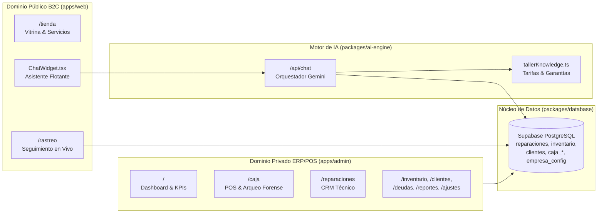

# 🏛️ Arquitectura del Sistema — Relojería IA (CTR)

Este documento describe la arquitectura técnica, el stack tecnológico y los patrones de diseño implementados en el ecosistema omnicanal de **Centro Técnico Relojero (CTR)**: ERP/POS Administrativo, Plataforma Pública B2C y Motor de Asistente Virtual con IA (RAG + Tool Calling).

---

## 🛠️ Stack Tecnológico

| Capa | Tecnología | Propósito |
| :--- | :--- | :--- |
| **Framework Web** | Next.js 16+ (App Router + Turbopack) | Renderizado híbrido SSR/CSR, Route Handlers y React Compiler |
| **Lenguaje** | TypeScript 5+ (Strict Mode) | Tipado estático y contratos de datos de extremo a extremo |
| **Estilos & UI** | Tailwind CSS v4 + Lucide React | Sistema visual dual: Operativo (ERP Light/Dark) y *Dark Luxury* (B2C) |
| **Backend & Persistencia** | Supabase (PostgreSQL + Auth + Realtime) | Base de datos relacional ACID, RLS y sincronización en vivo |
| **Inteligencia Artificial** | Google Gemini API (Flash / Flash-Lite) | Asistente conversacional con RAG dinámico y *Tool Calling* sobre reparaciones |

---

## 🏗️ Arquitectura de Dominios (Rumbo a Monorepo Turborepo)

El sistema está estructurado en tres dominios claramente delimitados (ver detalle en [ARQUITECTURA_B2C_RAG.md](file:///d:/Proyecto%20IA/RELOJERIA%20IA/docs/ARQUITECTURA_B2C_RAG.md)):

### 1. Núcleo de Seguridad y Sesión (`AuthProvider.tsx` & `supabase.ts`)
- **Protocolo `TITAN-IMMUNE`:** Cliente Supabase configurado con almacenamiento atómico en `sessionStorage` para evitar colisiones de Web Locks en el navegador.
- **Escudo Singleton:** `AuthProvider` mantiene una única suscripción a `onAuthStateChange`, consulta la tabla `perfiles` para obtener el `rol` (`admin`, `recepcion`, `tecnico`) y el estado `activo`, y protege las rutas internas del ERP permitiendo el paso libre a las rutas públicas B2C (`/tienda`, `/rastreo`).

### 2. Sincronización Global en Tiempo Real (`useSettings.tsx`)
- Provee la configuración de `empresa_config` (moneda principal, nombre, eslogan y pie de recibo).
- Suscribe un canal **Supabase Realtime** (`postgres_changes`) que actualiza instantáneamente el formato de moneda y recibos en todas las terminales conectadas.

### 3. Motor Financiero y POS Forense (`useCaja.ts` & `finanzasUtils.ts`)
- **Validación Estricta de Fondos:** Impide egresos en efectivo o cuentas bancarias (`BAC`, `LAFISE`, `BANPRO`) que superen el saldo disponible en gaveta o en `tesoreria_cuentas`.
- **Detección de Fugas y Arqueo Ciego:** Al abrir o cerrar sesión en `caja_sesiones`, compara automáticamente el saldo físico contra la bóveda y genera movimientos de ajuste (`Sobrante`/`Faltante`), permitiendo justificación forense posterior (`justifyShortage`).
- **Neutralización Contable de Anulaciones:** La utilidad `filtrarMovimientosValidos()` empareja y descarta tanto el movimiento original anulado como su contrapartida (`ANULACIÓN: ...`) para evitar distorsiones en el Dashboard y en el Estado de Resultados (P&L).

### 4. Plataforma B2C y Motor RAG / Tool Calling (`/rastreo`, `/tienda`, `/api/chat`)
- **Portal de Rastreo (`/rastreo`):** Permite a los clientes consultar el avance real de su reloj en 4 etapas (*Recepción → Mesa de Trabajo → Listo → Entregado*), ver su saldo pendiente exacto y compartir el enlace directo de su boleta.
- **Asistente Virtual IA (`/api/chat` + `ChatWidget.tsx`):**
  1. Detecta números de recibo en la consulta actual o en los últimos 5 mensajes de la conversación.
  2. Ejecuta una consulta en tiempo real a `reparaciones` y `clientes` en Supabase e inyecta los datos oficiales verificados en el contexto del modelo.
  3. Combina el contexto de base de datos con la base de conocimiento oficial del taller (`tallerKnowledge.ts`).
  4. Ejecuta inferencia rápida en Google Gemini con `thinkingBudget: 0` (evitando latencia adicional y cortes de texto) y cuenta con *fallback* automático entre modelos y timeout de 8 segundos.

---

*Última revisión técnica: Noviembre 2026*
