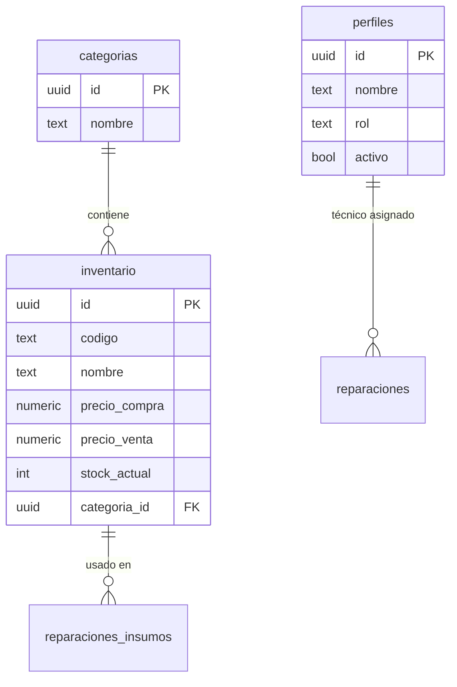

# 🗄️ Modelo de Base de Datos

El sistema utiliza **Supabase (PostgreSQL)** para el almacenamiento de datos. A continuación se detallan las tablas principales y sus relaciones.

## 📊 Tablas Implementadas

### 1. `categorias`
Define las agrupaciones lógicas para los productos del inventario.
- **`id`** (UUID, PK): Identificador único.
- **`nombre`** (TEXT, UNIQUE): Nombre de la categoría (ej. "Relojes Nuevos", "Baterías").
- **`descripcion`** (TEXT): Información adicional opcional.
- **`created_at`** (TIMESTAMP): Fecha de creación automática.

### 2. `inventario`
Almacena todos los productos (relojes y repuestos) del negocio.
- **`id`** (UUID, PK): Identificador único.
- **`codigo`** (TEXT, UNIQUE): SKU o código interno para búsqueda rápida.
- **`nombre`** (TEXT): Nombre descriptivo del artículo.
- **`marca`** (TEXT): Marca del fabricante.
- **`modelo`** (TEXT): Modelo específico.
- **`precio_compra`** (NUMERIC): Costo de adquisición (pestaña administrativa).
- **`precio_venta`** (NUMERIC): Precio final al cliente.
- **`stock_actual`** (INTEGER): Cantidad disponible en tiempo real.
- **`stock_minimo`** (INTEGER): Umbral para disparar alertas visuales (si es `-1`, la alerta está desactivada).
- **`categoria_id`** (UUID, FK): Relación con `categorias(id)`.
- **`estado`** (TEXT): "Nuevo", "Usado", "Restaurado" o "N/A".
- **`es_vendible`** (BOOLEAN): Define si el producto aparece en el catálogo de ventas rápidas.
- **`created_at`** (TIMESTAMP): Fecha de ingreso al sistema.

### 3. `perfiles` (Seguridad y Roles)
Extensión de la tabla de usuarios nativa de Supabase Auth.
- **`id`** (UUID, PK): Referencia directa a `auth.users(id)`.
- **`nombre`** (TEXT): Nombre completo del miembro del equipo.
- **`rol`** (TEXT): Nivel de acceso (`admin`, `recepcion`, `tecnico`).
- **`activo`** (BOOLEAN): Estado de la cuenta (permite suspender accesos).
- **`telefono`** (TEXT): Contacto de WhatsApp del miembro.
- **`created_at`** (TIMESTAMP): Fecha de registro del perfil.

## 🚧 Tablas en Desarrollo (Próximamente)

| Tabla | Propósito |
| :--- | :--- |
| `reparaciones` | Seguimiento de tickets, diagnósticos y técnicos asignados. |
| `transacciones` | Registro histórico de ingresos y egresos (Caja). |
| `deudas` | Cuentas por cobrar (clientes) y pagar (proveedores). |

## 📐 Diagrama de Relaciones (E/R)

