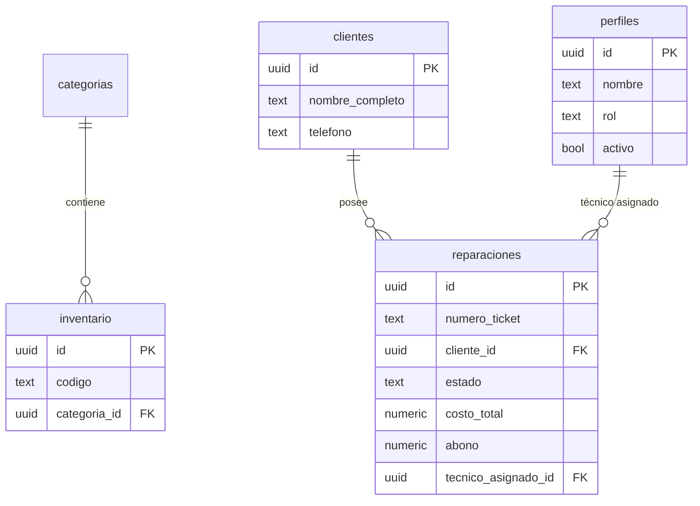

# 🗄️ Modelo de Base de Datos

El sistema utiliza **Supabase (PostgreSQL)** para el almacenamiento de datos. A continuación se detallan las tablas principales y sus relaciones.

## 📊 Tablas Implementadas

### 1. `categorias`
Define las agrupaciones lógicas para los productos del inventario.
- **`id`** (UUID, PK): Identificador único.
- **`nombre`** (TEXT, UNIQUE): Nombre de la categoría (ej. "Relojes Nuevos", "Baterías").
- **`descripcion`** (TEXT): Información adicional opcional.
- **`created_at`** (TIMESTAMP): Fecha de creación automática.

### 2. `inventario`
Almacena todos los productos (relojes y repuestos) del negocio.
- **`id`** (UUID, PK): Identificador único.
- **`codigo`** (TEXT, UNIQUE): SKU o código interno para búsqueda rápida.
- **`nombre`** (TEXT): Nombre descriptivo del artículo.
- **`marca`** (TEXT): Marca del fabricante.
- **`modelo`** (TEXT): Modelo específico.
- **`precio_compra`** (NUMERIC): Costo de adquisición (pestaña administrativa).
- **`precio_venta`** (NUMERIC): Precio final al cliente.
- **`stock_actual`** (INTEGER): Cantidad disponible en tiempo real.
- **`stock_minimo`** (INTEGER): Umbral para disparar alertas visuales (si es `-1`, la alerta está desactivada).
- **`categoria_id`** (UUID, FK): Relación con `categorias(id)`.
- **`estado`** (TEXT): "Nuevo", "Usado", "Restaurado" o "N/A".
- **`es_vendible`** (BOOLEAN): Define si el producto aparece en el catálogo de ventas rápidas.
- **`created_at`** (TIMESTAMP): Fecha de ingreso al sistema.

### 3. `perfiles` (Seguridad y Roles)
Extensión de la tabla de usuarios nativa de Supabase Auth.
- **`id`** (UUID, PK): Referencia directa a `auth.users(id)`.
- **`nombre`** (TEXT): Nombre completo del miembro del equipo.
- **`rol`** (TEXT): Nivel de acceso (`admin`, `recepcion`, `tecnico`).
- **`activo`** (BOOLEAN): Estado de la cuenta (permite suspender accesos).
- **`telefono`** (TEXT): Contacto de WhatsApp del miembro.
- **`created_at`** (TIMESTAMP): Fecha de registro del perfil.

### 4. `clientes`
Módulo de gestión de clientes para facturación y seguimiento.
- **`id`** (UUID, PK): Identificador único.
- **`nombre_completo`** (TEXT): Nombre y apellidos del cliente.
- **`telefono`** (TEXT): Contacto principal (WhatsApp).
- **`email`** (TEXT): Correo opcional.
- **`created_at`** (TIMESTAMP): Fecha de registro.

### 5. `reparaciones`
Núcleo del taller para el seguimiento de servicios técnicos.
- **`id`** (UUID, PK): Identificador único interno.
- **`numero_recibo`** (TEXT, UNIQUE): ID visible e importante para el cliente (ej. "REP-0001").
- **`cliente_id`** (UUID, FK): Relación con `clientes(id)`.
- **`fecha_ingreso`** (TIMESTAMP): Fecha en que entró el reloj.
- **`tipo_reloj`** (TEXT): Categoría (Pared, Pulso, Mecánico, etc).
- **`marca`** (TEXT): Marca del fabricante.
- **`modelo_descripcion`** (TEXT): Modelo o descripción breve.
- **`problema_cliente`** (TEXT): Descripción del fallo según el cliente.
- **`diagnostico_tecnico`** (TEXT): Evaluación técnica profesional.
- **`tecnico_asignado_id`** (UUID, FK): Relación con `perfiles(id)`.
- **`estado`** (TEXT): Estado actual del flujo.
- **`fecha_compromiso`** (TIMESTAMP): Fecha prometida al cliente.
- **`fecha_fin_reparacion`** (TIMESTAMP): Cuando el técnico termina el trabajo.
- **`fecha_entrega`** (TIMESTAMP): Cuando el cliente retira el reloj.
- **`precio_final`** (NUMERIC): Costo total pactado.
- **`abono`** (NUMERIC): Anticipo entregado.
- **`saldo_pendiente`** (NUMERIC): Calculado (`precio_final - abono`).
- **`metodo_pago`** (TEXT): Efectivo, Tarjeta, Transferencia.
- **`notas_internas`** (TEXT): Información privada para el taller.
- **`veces_garantia`** (INTEGER): Contador de retornos por el mismo servicio.
- **`created_at`** (TIMESTAMP): Registro automático.

## 📐 Diagrama de Relaciones Actualizado (E/R)

